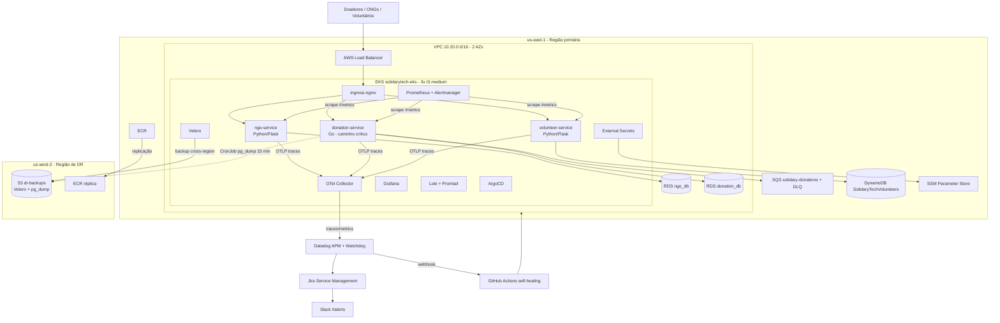
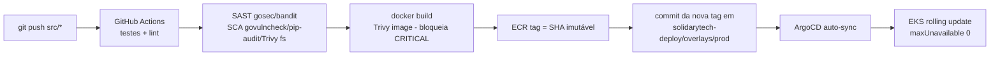

# Arquitetura - SolidaryTech

## Visão geral

## Fluxo de entrega (CI/CD + GitOps)

Não há `kubectl apply` manual nem recurso criado no console:

| Camada | Ferramenta | Onde |
|---|---|---|
| Infra AWS (rede, EKS, RDS, DynamoDB, SQS, ECR, S3, SSM, Budgets) | Terraform | `solidarytech-app/terraform` (workflow *Terraform Apply*) |
| Bootstrap do cluster (ArgoCD) | Helm via GitHub Actions | `solidarytech-deploy/.github/workflows/argocd-install.yml` |
| Tudo dentro do cluster | ArgoCD (App-of-Apps) | `solidarytech-deploy/k8s/apps` |
| Alertas, SLOs, webhook no Datadog | Terraform | `solidarytech-deploy/terraform/datadog` |

## Camadas Terraform

| Camada | Recursos | Depende de |
|---|---|---|
| `bootstrap` (1x, local) | bucket S3 do state (versionado, criptografado) | - |
| `networking` | VPC, 2 subnets públicas + 2 privadas, IGW, gateway endpoints S3/DynamoDB, SG default fechado | - |
| `security` | senhas aleatórias e tokens no SSM (SecureString) | - |
| `data` | 2x RDS PostgreSQL 16 (privado, TLS, PITR), DynamoDB on-demand + GSI + PITR, SQS + DLQ, parâmetros de conexão no SSM | networking, security |
| `platform` | 3 ECR (scan on push, imutável, lifecycle), replicação ECR -> us-west-2, bucket S3 de DR em us-west-2 | - |
| `compute` | EKS 1.36, node group gerenciado com launch template (IMDSv2, EBS gp3 criptografado, tags propagadas), add-ons gerenciados | networking |
| `finops` | AWS Budget mensal com alertas 50/80/100% e forecast | - |

## Decisões e restrições do AWS Academy

| Restrição | Decisão |
|---|---|
| Não é possível criar IAM Roles (sem IRSA/Pod Identity) | Cluster e nodes usam a `LabRole`. Pods usam a credencial do node via IMDSv2 com hop limit 2. Nenhuma access key fica em pod ou no Git. |
| Secrets Manager bloqueado | SSM Parameter Store (SecureString) + External Secrets Operator |
| Créditos limitados | Sem NAT Gateway (nodes em subnet pública com SG), DynamoDB on-demand, 1 réplica de RDS por banco, destroy entre sessões |
| Credenciais temporárias | Secrets do GitHub renovados por sessão; workflow *Preflight Check* valida antes de tudo |

## Segurança aplicada

- Imagens: multi-stage, distroless (Go) e slim (Python), usuário não-root, `readOnlyRootFilesystem`, `drop: ALL`, seccomp `RuntimeDefault`.
- Namespace com Pod Security Admission (`enforce: baseline`, `warn/audit: restricted`).
- RDS em subnets privadas, SG restrito à VPC, `rds.force_ssl=1`, storage criptografado.
- S3 de DR: versionamento, SSE, bloqueio de acesso público, política só-HTTPS.
- Pipeline: SAST (gosec, bandit), SCA (govulncheck, pip-audit, Trivy fs), scan de imagem (Trivy, bloqueia CRITICAL), IaC scan (Checkov, tflint), segredos (Trivy secret scanner).
- Endpoint `/admin/chaos` (injeção de falhas para demo) protegido por token do SSM.
