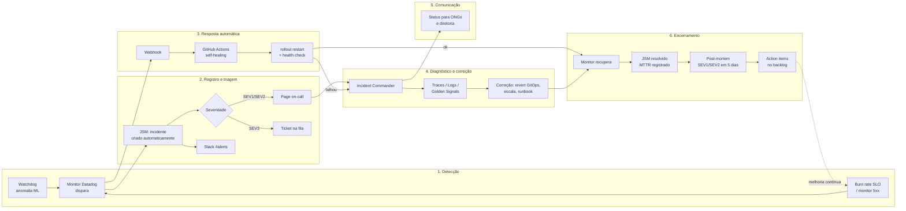

# ITSM e AIOps - Gestão de incidentes da SolidaryTech

## 1. Ferramentas

| Função | Ferramenta |
|---|---|
| Detecção preditiva (AIOps) | **Datadog Watchdog**: ML sobre latência, erros e tráfego do APM, sem limiar fixo |
| Detecção por limiar e SLO | monitores Datadog (5xx, latência, burn rate do SLO) e alertas Prometheus (multi-burn-rate) |
| Gestão do incidente | **Jira Service Management** (fila "SolidaryTech Incidents", integração Datadog) |
| Comunicação interna (ChatOps) | **Slack `#alerts`** (via JSM e Datadog) |
| Automação de resposta | webhook do Datadog -> GitHub Actions `self-healing.yml` (`rollout restart` e verificação) |
| Diagnóstico | Datadog APM (traces distribuídos, Service Map), Logs, Grafana Golden Signals, Loki |
| Conhecimento | runbooks (`docs/runbooks`), post-mortems (`docs/postmortem-template.md`) |

Tudo que é configurável por API está em Terraform (`solidarytech-deploy/terraform/datadog`): monitores, Watchdog, SLOs, webhook e dashboard. As integrações JSM e Slack são autorizadas uma vez na interface do Datadog e do JSM (OAuth).

## 2. Ciclo de vida do incidente

### Etapas, responsáveis e prazos

| # | Etapa | Responsável | Prazo / meta |
|---|---|---|---|
| 1 | **Detecção:** Watchdog (preditivo) ou monitor/burn rate | automático | < 5 min do início |
| 2 | **Registro:** incidente no JSM com prioridade herdada do monitor (P1 = donation-service) | automático | imediato |
| 3 | **Triagem:** confirmar impacto e definir severidade | on-call | SEV1: ack em 5 min |
| 4 | **Resposta automática:** self-healing executa e registra a linha do tempo no resumo do job | automático | < 3 min |
| 5 | **Escalonamento:** se o self-healing falhar ou o burn rate continuar, o Incident Commander assume | on-call / IC | SEV1: 15 min |
| 6 | **Diagnóstico e correção:** traces, logs, runbook; correção via GitOps | IC + equipe | MTTR alvo SEV1 < 30 min |
| 7 | **Comunicação:** status para ONGs e diretoria (templates abaixo) | Comms lead (IC na equipe pequena) | SEV1: 30 min; atualização a cada 30 min |
| 8 | **Resolução:** monitor recuperado, incidente resolvido no JSM | IC | - |
| 9 | **Post-mortem** sem culpados, com action items | IC | SEV1/SEV2: 5 dias úteis |
| 10 | **Melhoria:** action items priorizados conforme a política de error budget | time | próximo ciclo |

## 3. Matriz de severidade

| Sev | Critério | Exemplo | Notificação |
|---|---|---|---|
| **SEV1** | doações não processam, ou burn rate 14,4x do SLO de disponibilidade | donation-service com 30% de 5xx | page + Slack + status externo |
| **SEV2** | degradação do caminho crítico ou indisponibilidade de serviço secundário | latência p95 > 300 ms; ngo-service fora | page em horário comercial + Slack |
| **SEV3** | risco sem impacto no usuário | backup falhou, pod reiniciando, anomalia Watchdog sem violar SLO | ticket JSM |

## 4. AIOps: o que o Watchdog adiciona

- Detecta **desvios do padrão** aprendido (sazonalidade por hora e dia) em latência, taxa de erro e hits de cada serviço do APM, sem limiar manual. Isso cobre o cenário de picos imprevisíveis citado pela diretoria.
- Agrupa sintomas correlacionados em uma *story* com **causa provável** (ex.: aumento de latência no donation-service correlacionado ao span `postgresql` do RDS). Isso encurta o diagnóstico.
- O monitor `[SolidaryTech] Watchdog - anomalia detectada (AIOps)` transforma cada story em alerta para o JSM e o Slack. A anomalia chega **antes** de o error budget se esgotar.
- Configuração: o Watchdog é ativado automaticamente quando há dados de APM. O monitor fica em `terraform/datadog/main.tf`.

## 5. Templates de comunicação

**Status inicial (SEV1), em até 30 min:**
> **[Investigando] Instabilidade no recebimento de doações.** Desde HH:MM algumas doações podem falhar ao serem enviadas. Doações já confirmadas estão seguras. Nossa equipe está atuando e a próxima atualização sai às HH:MM.

**Atualização:**
> **[Identificado]** A causa foi identificada (<resumo não técnico>). A correção está em andamento. Previsão de normalização: HH:MM.

**Resolução:**
> **[Resolvido]** O recebimento de doações está normalizado desde HH:MM (duração: X min). Publicaremos a análise de causa e as ações preventivas em até 5 dias úteis.

## 6. Métricas do processo

| Métrica | Fonte |
|---|---|
| MTTD (tempo até detectar) | horário do alerta no Datadog menos o início no gráfico |
| MTTA (tempo até o ack) | JSM |
| **MTTR** | JSM (abertura até resolução) e resumo do workflow de self-healing |
| Incidentes por mês / % resolvidos por automação | JSM (filtro label `self-healing`) |
| Error budget consumido por incidente | dashboard SLO |

## 7. Configuração (passo único, fora do Terraform)

1. JSM: criar o projeto *IT Service Management* e, em **Operations > Integrations**, adicionar **Datadog**. Copiar a API key.
2. Datadog: *Integrations > Jira Service Management*, colar a key, nome `solidarytech`. O handle fica `@jsm-solidarytech`.
3. Slack: no JSM e no Datadog (*Integrations > Slack*), autorizar o workspace e o canal `#alerts`. O handle fica `@slack-solidarytech-alerts`.
4. GitHub: PAT fine-grained com *Contents: read* e *Actions: write* no `solidarytech-deploy`, salvo no SSM `/solidarytech/prod/github/webhook-pat`.
5. Rodar o workflow *Datadog Terraform* com `apply`.
